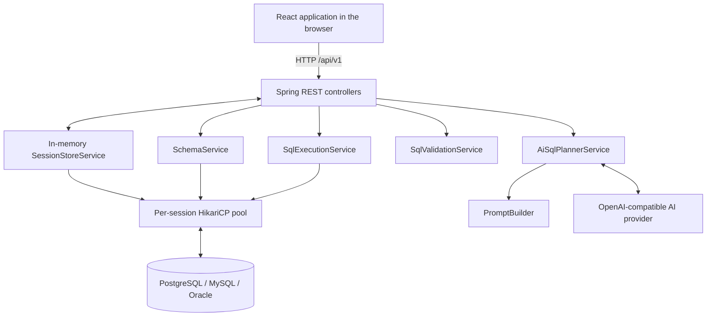
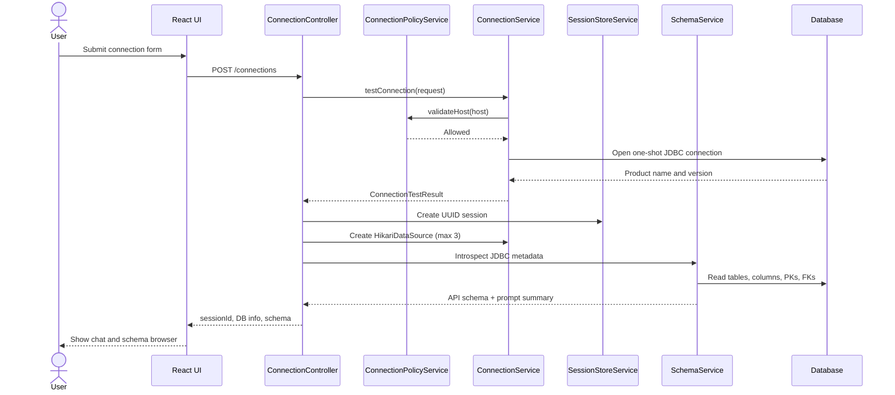
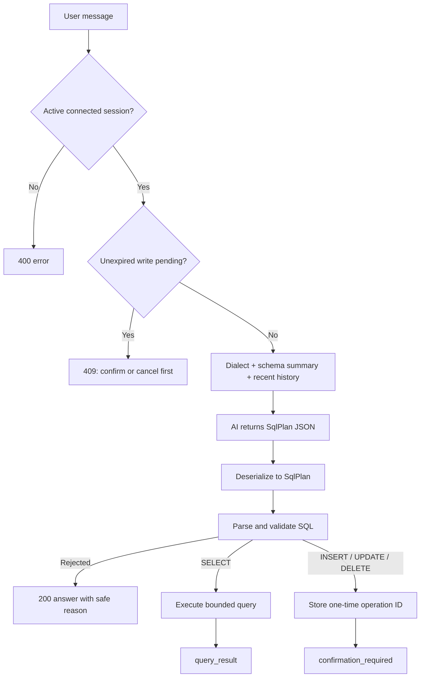
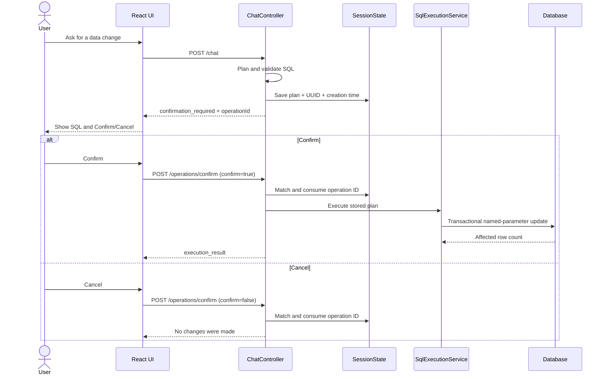

# Complete Application Flow

This guide explains how the React frontend, Spring Boot API, AI planner, SQL safety layer, and connected database work together. Start with the overview, then follow the individual flows when debugging or extending the project.

## 1. System overview



The main design rule is separation of planning and execution:

- The AI provider receives the SQL dialect, a bounded schema summary, recent chat context, and the user's question.
- It returns JSON representing a `SqlPlan`; it has no database credentials or connection.
- The backend treats that JSON as untrusted and parses and validates its SQL.
- Only `SqlExecutionService` can send an accepted plan to the session's database pool.

## 2. Startup and frontend communication

`AiAssistedDatabaseAgentApplication` starts Spring Boot with scheduled cleanup enabled. Configuration comes from `application.properties` and environment variables. The server listens on port `8083` unless `SERVER_PORT` overrides it.

During frontend development, Vite serves React on port `5173`. The frontend API client always requests relative paths under `/api/v1`; Vite proxies `/api` to `http://localhost:8083`. In the production Docker image, Vite's compiled files are copied into Spring Boot's static resources, so the browser and API use the same origin.

Every frontend request has a 60-second browser-side timeout. Non-2xx responses are converted to JavaScript errors using the backend's `message` or `errorMessage` field.

## 3. Database connection flow

Entry point: `POST /api/v1/connections`



Detailed steps:

1. `ConnectPanel` collects the dialect, host, port, database/service name, username, password, optional schema, and SSL selection.
2. Bean validation rejects malformed input before controller logic runs.
3. `ConnectionPolicyService` accepts only exact allowlisted hosts or configured wildcard suffixes. It rejects URL-like host values.
4. `ConnectionService` creates the dialect-specific JDBC URL and performs a one-shot connection test.
5. On success, the controller creates a random session ID and an in-memory `SessionState`.
6. A Hikari pool is attached to that session. Its maximum size is 3 and its credentials remain only in the live datasource configuration.
7. `SchemaService` reads at most 200 tables and 200 columns per table. It records type, nullability, primary-key status, and foreign-key targets.
8. The service creates two schema representations: structured JSON for the UI and a compact text summary for AI prompts.
9. The frontend stores the session ID in React state and replaces the connection screen with the chat screen.

If connection testing fails, the API returns a sanitized error. If pool creation or introspection fails after a session is allocated, the session is removed and its datasource is closed.

## 4. Natural-language request and planning flow

Entry point: `POST /api/v1/chat`



`AiSqlPlannerService` and `PromptBuilder` assemble the model request:

1. State the connected dialect and its limit syntax.
2. Include the discovered schema inside an explicitly untrusted metadata section.
3. Require one JSON object matching `SqlPlan`.
4. Require named placeholders for user values and forbid DDL, procedures, file operations, locking reads, and unrelated vendor commands.
5. Include the most recent 6 stored history entries for context.
6. Send the prompt through Spring AI with temperature `0.0`.
7. Remove optional Markdown fences and deserialize the JSON with Jackson.

An example plan is:

```json
{
  "intent": "SELECT",
  "dialect": "POSTGRES",
  "sql": "SELECT id, name FROM customers WHERE status = :status LIMIT 10",
  "params": { "status": "ACTIVE" },
  "destructive": false,
  "requiresConfirmation": false,
  "reason": "Finds active customers."
}
```

No model response is trusted merely because it matches this structure.

## 5. SQL validation flow

`SqlValidationService` is the enforcement boundary between AI planning and database execution. It checks:

1. A plan exists and its intent is one of `SELECT`, `INSERT`, `UPDATE`, or `DELETE`.
2. `DDL`, `DDL_BLOCKED`, and unsupported/non-database intents do not execute.
3. The plan dialect matches the connected database.
4. SQL is present and no longer than 20,000 characters.
5. JSqlParser can parse the SQL as exactly one statement.
6. The parsed statement class matches the declared intent.
7. A `SELECT` contains no side-effecting or locking construct.
8. Named placeholders in SQL exactly match the keys in `params`.
9. Writes require confirmation regardless of the model's boolean flags.

A rejected plan returns a normal `answer` response containing a safe reason and is recorded in history as blocked. It is never passed to JDBC.

## 6. Read-query flow

For a validated `SELECT`:

1. `ChatController` calls `SqlExecutionService.execute`.
2. The service creates a `NamedParameterJdbcTemplate` for the session datasource.
3. It applies the configured query timeout and JDBC maximum of 100 rows.
4. Named parameters are bound separately from the SQL text.
5. Column labels and ordered row maps are collected from JDBC metadata and the result set.
6. The API returns `type: "query_result"` with the answer, plan, columns, and rows.
7. `parseAiResponse` converts this to a table message and `DataTable` renders it.
8. The user question and result summary are added to session history.

```text
User question -> plan -> policy pass -> named-parameter query
              -> at most 100 rows -> JSON response -> table in browser
```

## 7. Write and confirmation flow

All validated `INSERT`, `UPDATE`, and `DELETE` plans take a two-request path.



Important guarantees:

- The server stores the validated plan; the browser does not send editable SQL back for execution.
- Confirmation must contain the owning session ID and exact operation ID.
- The pending plan is consumed before execution, so the ID cannot be replayed after success or failure.
- The default operation lifetime is 10 minutes. An expired confirmation returns HTTP `410`.
- Only one unexpired write can be pending in a session. Another chat request returns HTTP `409`.
- A confirmed write runs inside a Spring transaction and returns the affected row count.
- Cancel, clear history, disconnect, expiry, failure, or success removes the pending operation.

## 8. Schema refresh, history, and disconnect

### Refresh schema

`GET /api/v1/sessions/{sessionId}/schema` repeats JDBC metadata discovery, updates both schema representations in `SessionState`, and returns the structured schema. Future prompts immediately use the refreshed summary.

### Clear chat

`DELETE /api/v1/sessions/{sessionId}/history` clears backend prompt history and any pending write. The frontend then clears its displayed messages and pending operation ID.

### Disconnect

`DELETE /api/v1/sessions/{sessionId}` removes the session, closes its Hikari datasource, clears its history and pending operation, and resets React state. The endpoint is idempotent.

## 9. Session lifecycle

Each `SessionState` contains:

- session ID and last-access timestamp
- connected database dialect and Hikari datasource
- structured schema and compact prompt summary
- optional schema filter
- up to 20 chat history entries
- zero or one pending write operation

Every session lookup updates its last-access time. Once per minute, `SessionStoreService` removes sessions inactive for longer than the configured TTL (30 minutes by default) and closes their pools. Application shutdown also closes all remaining pools. Because this state is in memory, a backend restart invalidates every session.

## 10. Error paths

| Stage | Typical status | Result |
|---|---:|---|
| Request validation | `400` | Stable validation error response |
| Host not allowlisted | `403` | Connection blocked before JDBC access |
| Database connection failure | `400` | Sanitized connection message |
| Schema discovery failure | `422` | New session cleaned up |
| Missing/expired session | `400` | User must reconnect |
| Pending write conflict | `409` | User must confirm or cancel it |
| AI call or plan parsing failure | `502` | No SQL executed |
| SQL policy rejection | `200` | Safe explanatory `answer`; no SQL executed |
| Expired operation ID | `410` | Plan consumed; generate it again |
| Confirmed write rejected by DB | `422` | Safe error; operation ID cannot be retried |

`ApiExceptionHandler` maps validation and service exceptions to stable client responses. Internal provider payloads, raw database errors, stack traces, SQL text, and credentials are not intentionally returned to the browser.

## 11. Source-code map

All abbreviated backend paths start at `AI-Assisted_Database_Agent/src/main/java/com/guru/AI_Assisted_Database_Agent`.

| Responsibility | Source |
|---|---|
| Main frontend state and handlers | `ai_db_agent_ui/src/App.jsx` |
| HTTP wrapper | `ai_db_agent_ui/src/services/api.js` |
| Connection endpoints | `controller/ConnectionController.java` |
| Chat and confirmation endpoints | `controller/ChatController.java` |
| JDBC URL, test, and pool creation | `service/ConnectionService.java` |
| Host allowlist | `service/ConnectionPolicyService.java` |
| JDBC metadata discovery | `service/SchemaService.java` |
| AI request and JSON parsing | `service/AiSqlPlannerService.java` |
| Model instructions | `ai/PromptBuilder.java` |
| SQL enforcement | `service/SqlValidationService.java` |
| JDBC execution | `service/SqlExecutionService.java` |
| Session cleanup | `service/SessionStoreService.java` |
| Runtime settings | `AI-Assisted_Database_Agent/src/main/resources/application.properties` |

## 12. Safe extension points

- Add API actions in controllers, but keep database rules in validation and execution services.
- Treat prompt guidance as an aid and enforce every safety requirement again in Java.
- Extend database support through `DbType`, JDBC construction, prompt syntax, validation, and tests together.
- Never execute SQL received from a confirmation request; execute only the server-stored pending plan.
- If sessions move to a shared store, explicitly redesign database pool ownership and cleanup.
- Add authentication and bind sessions to authenticated owners before multi-user or public deployment.
